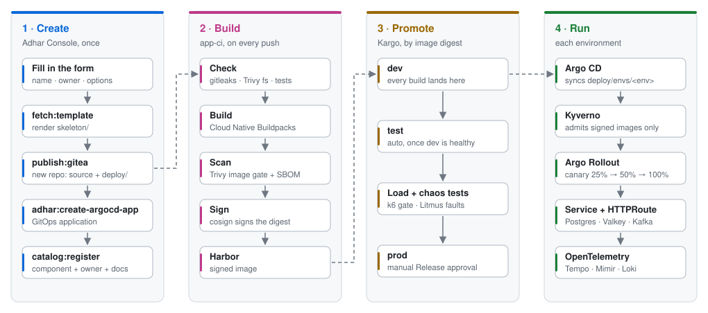

<div align="center">

<picture>
  <source media="(prefers-color-scheme: dark)" srcset=".github/assets/adhar-logo-dark.svg">
  
</picture>

# Adhar Templates - Golden paths for the Adhar IDP

[](https://backstage.io/docs/features/software-templates/)
[](https://argo-cd.readthedocs.io/)
[](#the-secure-supply-chain)
[](https://www.crossplane.io/)
[](#license)

</div>

> Pick a template in the Adhar Console, fill in a short form, and get a running, signed, observable service, with no boilerplate and no infra tickets.


## Why

Starting a new service usually means a week of glue work before the first
feature: a build, a registry, an image scan, a signature, manifests, an ingress
route, a database, dashboards, an entry in the catalog. Each template here does
all of that in one step. The generated repository belongs to your team, so you
can customise and maintain it like any other code, and it is already wired to
the platform:

- 🔐 **Secure by default.** Images are built with buildpacks (no Dockerfile),
  scanned with Trivy, given an SBOM, signed with cosign, and checked again by
  Kyverno at admission. If the platform did not sign an image, it does not run.
- 🚀 **Promoted, then progressively delivered.** Every build lands in `dev`.
  Kargo promotes the signed digest to `test` once `dev` is healthy, and to
  `prod` on a manual Release. In each environment Argo Rollouts shifts traffic
  in canary steps.
- 📈 **Observable from the first request.** OpenTelemetry sends traces, metrics
  and logs to Tempo, Mimir and Loki with nothing to configure.
- 🧩 **Backing services on demand.** PostgreSQL, a Valkey cache and Kafka are
  provisioned next to the app, and their connection details reach it as
  environment variables, never as committed secrets.
- 🛡️ **Production-ready from day one.** The form's **Operations** step sets
  lifecycle, tier, SLO, runbook and on-call, and ships alerts, a
  PodDisruptionBudget, optional autoscaling, a k6 load test and automated
  chaos experiments, so the service starts with a scorecard score instead of
  earning one later.
- 🌐 **Frontends that editors and translators can change.** The React,
  Angular and TanStack Start apps load their texts from Tolgee, can read
  content from the platform's Strapi CMS, and report real-user monitoring and
  product analytics, all configured at runtime per environment.
- 📚 **Documented and catalogued.** Every app ships with TechDocs (`docs/` and
  `mkdocs.yml`) and registers itself in the Service Catalog with its owner.

## Template catalog

### Applications

Each of these creates its own Gitea repository (source plus a GitOps `deploy/`
tree with `dev`, `test` and `prod` overlays) and an Argo CD Application.

| Template | Stack | Backing services | Highlights |
|---|---|---|---|
| [`springboot-web-service`](templates/springboot-web-service) | Java 25 · Spring Boot 4 · Adhar Kit | Postgres · Valkey · Kafka (each optional) | ⭐ Recommended Java golden path, Keycloak JWT auth, `compose.yaml` for local dev |
| [`springboot-hexagon-service`](templates/springboot-hexagon-service) | Java 25 · Spring Boot 4 · Adhar Kit | Postgres (optional) | Ports and adapters layout, Keycloak JWT auth |
| [`springboot-gateway-service`](templates/springboot-gateway-service) | Java 25 · Spring Cloud Gateway (WebFlux) · Adhar Kit | Valkey for rate limiting (optional) | API gateway: JWT auth, rate limits, circuit breakers, load shedding |
| [`quarkus-web-service`](templates/quarkus-web-service) | Java 21 · Quarkus 3 | Postgres (optional) | Fast startup, low memory |
| [`nodejs-web-service`](templates/nodejs-web-service) | Node.js · Express | Postgres (optional) | |
| [`go-web-service`](templates/go-web-service) | Go 1.25 · net/http | Postgres (optional) | Minimal image, OTel built in |
| [`python-web-service`](templates/python-web-service) | Python · Flask · gunicorn | Postgres (optional) | |
| [`tanstack-start-fullstack-app`](templates/tanstack-start-fullstack-app) | TanStack Start · React 19 · Adhar UI | Postgres (optional) | Full-stack SSR + server routes; Tolgee, PostHog, Strapi CMS (optional) |
| [`react-spa-app`](templates/react-spa-app) | React 19 · Vite · Adhar UI | | Static SPA served by nginx; Tolgee, PostHog, Strapi CMS (optional) |
| [`angular-spa-app`](templates/angular-spa-app) | Angular 20 · Adhar UI | | Static SPA served by nginx; Tolgee, PostHog, Strapi CMS (optional) |
| [`agent-service`](templates/agent-service) | Python · FastAPI AI agent | | ⭐ Isolated `AgentWorkload`: own namespace, default-deny network, gateway identity limited to the models and tools you list, token budget alerts |

## How it works

<picture>
  <source media="(prefers-color-scheme: dark)" srcset=".github/assets/how-it-works-dark.svg">
  
</picture>

1. The **platform bootstrap** mirrors this repository into Gitea and registers
   [`catalog-info.yaml`](catalog-info.yaml), a Backstage `Location` that lists
   every template, so all of them appear under **Create**.
2. **Scaffolding** renders the template's `skeleton/` with the form values and
   publishes it to a new Gitea repository. It then creates an Argo CD
   Application for `deploy/`, registers the component in the catalog, and
   copies `perf/` into the Performance Center as the service's load test.
3. **Every push** runs the platform's `app-ci` pipeline. The new repository has
   nothing to define.
4. **Kargo** promotes the signed image digest by editing only the `images:`
   block of each overlay in `deploy/envs/`: `dev` on every build, `test`
   automatically once `dev` is healthy, and `prod` only through a manually
   approved Release.
5. **Argo CD** syncs each overlay into the project's namespace for that
   environment. Kyverno admits only the signed image and pins it to the
   verified digest, and Argo Rollouts rolls it out as a canary (25%, 50%,
   100%). Backing-service claims in the same tree are reconciled by
   CloudNativePG and the Crossplane control plane.
6. **In `test`**, the platform runs the k6 load test against the latency
   target and, if chaos testing is on, a daily series of Litmus faults. Each
   result feeds the service's production-readiness scorecard. Chaos never runs
   in `prod`.

### The secure supply chain

| Stage | Tool | Guarantee |
|---|---|---|
| Build | Cloud Native Buildpacks (kpack) | Reproducible image, no Dockerfile drift |
| Check | gitleaks, Trivy (source + manifests), unit tests | Leaks and vulnerable dependencies fail the build |
| Scan | Trivy (image) + syft SBOM | Enforced severity gate, SBOM attested |
| Sign | cosign | Signs the digest only after every gate passes |
| Admit | Kyverno `verify-supply-chain-images` | Unsigned images never start, including ones applied by hand |
| Promote | Kargo | The digest that passed `dev` is the one that reaches `test` and `prod` |
| Deploy | Argo CD + Argo Rollouts | Git is the source of truth, and a revert is the rollback |

## Spring Boot: pick your backing services

`springboot-web-service` has a **Backing services** step in its form. Every
option is an unticked checkbox, so you only tick what the service needs. Each
one you select adds a manifest to `deploy/`, its dependencies to `pom.xml`,
configuration, sample code and a local container in `compose.yaml`:

| Option | Provisioned by | Injected as | Sample code |
|---|---|---|---|
| **PostgreSQL database** | CloudNativePG `Cluster` with WAL archiving and a daily backup | `SPRING_DATASOURCE_URL` / `_USERNAME` / `_PASSWORD` | `GET /db` |
| **Valkey cache** (with a TTL) | Control-plane `Database` claim (`engine: redis`) | `SPRING_DATA_REDIS_URL`, used by **adhar-kit-cache** as the `@Cacheable` store | `GET`/`DELETE /cache/{key}` |
| **Kafka event stream** (topic and partitions) | Control-plane `Messaging` claim (Strimzi KRaft) | `SPRING_KAFKA_BOOTSTRAP_SERVERS` | `POST`/`GET /events` with a `@KafkaListener` |

Both Spring templates also have a **Require authentication (Keycloak JWT)**
checkbox, ticked by default. When it is ticked, every endpoint except
`/actuator/health` and `/actuator/info` needs a bearer token from the platform's
`adhar` realm, checked against the realm's JWKS by Adhar Kit's security module.
When it is unticked, the service is public. Health probes are open either way.

Credentials stay in Secrets that the platform generates. The generated code
contains no hostnames and no passwords, and every setting falls back to the
`localhost` ports in `compose.yaml` for local development.

## Spring Cloud Gateway: one front door

`springboot-gateway-service` puts many services behind one reactive gateway
(Spring Cloud Gateway on WebFlux and Reactor Netty). Its form asks for the first
route (a path prefix and an upstream URL) and a **Traffic policy**:

| Protection | Default | Behaviour |
|---|---|---|
| Keycloak JWT | on | Realm roles become `ROLE_<role>`; the caller's identity reaches the upstream as `X-User-ID` / `X-User-Roles`, and spoofed values are removed |
| Rate limit per caller | on, 100/s, burst 200 | Token bucket in a Valkey claim, shared by every replica; `429` over the limit |
| Upstream timeout | 5 s | `504` problem response |
| Load shedding | 2,000 in flight per replica | `503` with `Retry-After` instead of slowing every request down |
| CORS | no origins | Exact allow-list of browser origins |

Every route also runs behind a circuit breaker, a bulkhead and a GET-only retry,
with fallbacks that answer RFC 9457 problems. Autoscaling is on by default.

The gateway uses `adhar-kit-parent` and the kit's framework-neutral modules, not
`adhar-kit-starter`: in Adhar Kit 0.1.0 the starter and the security and logging
modules are built for Spring MVC and cannot run in a reactive application. The
generated `docs/architecture.md` explains what the gateway does instead.

## Frontend apps: texts, content and telemetry

`react-spa-app`, `angular-spa-app` and `tanstack-start-fullstack-app` share
three opt-in integrations. Each one is configured at runtime from an optional
Secret in the environment's namespace, so the one image promoted from `dev` to
`prod` uses each environment's own settings, and an app without the Secret
starts and works without the feature.

| Form step | Default | What the app gets | Configured by |
|---|---|---|---|
| **Localisation** (Tolgee) | on | Texts in `src/i18n/<language>.json`, served at `/i18n/<language>.json` from Tolgee with the built-in files as the fallback; a language switcher | Secret `<app>-tolgee` (`api-url`, `project-id`, read-only `api-key`) |
| **Analytics** (PostHog) | on | Product analytics through `/ingest` on the app's own origin, with Do Not Track and an opt-out respected. Grafana Faro real-user monitoring is always on. | Secret `<app>-posthog` (`api-key`, `host`) |
| **Content** (Strapi) | off | Strapi's REST API at `/cms/` and its media at `/uploads/`, read-only; a home-page section listing the latest entries of one content type, in the current language | Secret `<app>-strapi` (`api-token`, optional `api-url`) |

### Content from Strapi

The platform runs one shared **Strapi** CMS in `adhar-system`. Opt in with
**Content from Strapi** in the form and name the collection type to show
(`articles` by default). The app is then wired to it with nothing to configure
in code:

- **Server-side proxy.** The browser calls `/cms/<path>` on the app's own origin.
  nginx (the SPAs) or the app's Node server (TanStack Start) forwards it to
  Strapi's `/api/<path>` at `http://strapi.adhar-system.svc.cluster.local:1337`
  and adds the API token there. The token never reaches the browser. Strapi's
  public address is behind the platform's single sign-on, so a browser could
  not call it directly anyway.
- **Read-only by construction.** Only GET passes. Strapi's `users`,
  `users-permissions`, `auth`, `connect` and `upload` endpoints are refused
  whatever the token allows, because the CMS is shared by every app.
- **Language-aware.** Entries are requested in the language the app is shown
  in, and fall back to the default locale for content types that are not
  localised.
- **Failure-tolerant.** A missing token shows a setup hint (`X-Cms: off`), an
  empty collection says how to publish the first entry, and a Strapi outage
  costs the section, never the page.
- **Tested.** Playwright covers every state of the page. The proxy is tested in
  a real nginx against a stand-in Strapi (SPAs) or with unit tests (TanStack
  Start).

**One manual step today.** Nothing on the platform issues Strapi API tokens yet.
Per environment, create a **Read-only** token in Strapi (*Settings → API
Tokens*), or a **Custom** one limited to `find`/`findOne` on the app's content
types, and store it:

```sh
kubectl -n <env> create secret generic <app>-strapi --from-literal=api-token=<token>
```

The app picks it up on its next restart. Each generated app's README and
`docs/` cover setup, local development and troubleshooting.

## Every template: the Operations step

All templates end with the same **Operations** step. Its answers land in
`catalog-info.yaml` and the deploy manifests, which is what on-call and the
scorecard read.

| Field | Default | Where it goes |
|---|---|---|
| Lifecycle | `experimental` | Catalog `spec.lifecycle` |
| Tier | `standard` | `adhar.io/tier`, sets alert severity |
| Documentation, runbook, on-call | empty | Catalog annotations and links |
| Availability SLO | `99.9` | `adhar.io/slo`, the target alerts are tuned against |
| Latency target (p95) | `500` ms | k6 thresholds and the Performance Center gate |
| Load-test path | readiness probe | The endpoint `perf/load.js` calls |
| Automated chaos testing | on | Daily Litmus faults in `test` (`pod-delete`, `pod-network-latency`, `pod-cpu-hog` by default) |
| Alerts | on | `PrometheusRule` for restarts, unavailable pods and 5xx |
| PodDisruptionBudget | on | Keeps one replica through drains and upgrades |
| Autoscale on CPU | off | `HorizontalPodAutoscaler` at 70% CPU, up to the maximum replicas |

Every template also takes optional **custom hostnames**. The service always
answers on `<name>.<environment>.<platform domain>`, and the extra hostnames are
added to the `prod` route.

## Repository layout

```text
adhar-templates/
├── catalog-info.yaml          # Backstage Location: registers every template
├── org.yaml                   # owner groups the templates and OwnerPicker use
└── templates/
    └── <name>/
        ├── template.yaml      # the form (parameters) + scaffolder steps
        └── skeleton/          # rendered into the new app's repository
            ├── catalog-info.yaml   # the new component's catalog entry
            ├── mkdocs.yml, docs/   # TechDocs: overview, architecture, operations
            ├── perf/               # k6 load test + Performance Center gate
            ├── <app source>
            ├── compose.yaml        # local dependencies (the Spring Boot templates)
            └── deploy/             # GitOps tree Argo CD syncs
                ├── base/
                │   ├── kustomization.yaml
                │   ├── rollout.yaml    # Argo Rollout (canary) of the signed image
                │   ├── service.yaml
                │   ├── httproute.yaml  # Gateway API route
                │   ├── alerts.yaml     # PrometheusRule      (if enabled)
                │   ├── pdb.yaml        # PodDisruptionBudget (if enabled)
                │   ├── hpa.yaml        # autoscaler          (if enabled)
                │   ├── database.yaml   # CloudNativePG cluster   (if requested)
                │   ├── cache.yaml      # Valkey claim            (if requested)
                │   └── kafka.yaml      # Kafka claim + topics    (if requested)
                └── envs/
                    ├── dev/            # namespace, image digest, hostnames
                    ├── test/           # 2 replicas, so chaos tests measure resilience
                    └── prod/           # 2 replicas, promoted by Release only
```

## Authoring a template

1. Copy the closest existing template under `templates/`.
2. Edit `template.yaml`: set `metadata.name`, `title`, `description` and `tags`,
   then add form `parameters` and pass them to `fetch:template` as `values`.
3. In `skeleton/`, reference values as `${{ values.name }}` and use
   ` … ` for optional pieces. Wrap a whole
   manifest in a condition, as `deploy/base/database.yaml` does, so it renders
   empty when the option is off, or list it conditionally in
   `deploy/base/kustomization.yaml`, as `pdb.yaml` and `hpa.yaml` are.
4. Add the template to `targets` in [`catalog-info.yaml`](catalog-info.yaml).
5. Follow these conventions:
   - **Leave `hostname` and the `*HostnamesJson` values as local fallbacks.**
     The Console and CLI replace them with the cluster's real base domain
     before rendering.
   - **Keep the Operations step** and pass its values to `fetch:template`, or
     the alerts, PDB, HPA and SLO never reach the skeleton.
   - **Never edit `images:` in the overlays by hand.** Kargo owns that block,
     so put environment differences in `patches:`.
   - **Commit no secrets.** Reference Secrets by name from `deploy/base/rollout.yaml`.
   - **Set probes, requests and limits** on every container, with probe
     timeouts above one second. The scorecard checks for all of them.
   - **Ship `docs/`** that explain the generated service rather than the
     template.

## Run it locally

The whole chain runs on a local `adhar up` Kind cluster: build, sign, scan,
verify, deploy, and real databases, caches and brokers. Behaviour on the
platform matches behaviour on your laptop, and no cloud account is needed.

**Platform prerequisites** (all enabled in the local profile): the
`supply-chain` package (kpack builder `adhar-builder`, the `adhar-pipeline`
service account, the cosign key and the `verify-supply-chain-images` Kyverno
policy), plus `harbor`, `cnpg`, `kyverno`, `argo-rollouts`, and the Crossplane
control plane for cache, Kafka and other self-service resources. Promotion
needs Kargo, and the load and chaos tests need the Performance Center and
Litmus. Strapi is not in the local profile (it is amd64-only and too heavy for
Kind), so a frontend with **Content from Strapi** shows its setup hint locally
unless you point `STRAPI_URL` at a Strapi of your own.

## License

[Apache-2.0](https://www.apache.org/licenses/LICENSE-2.0)
