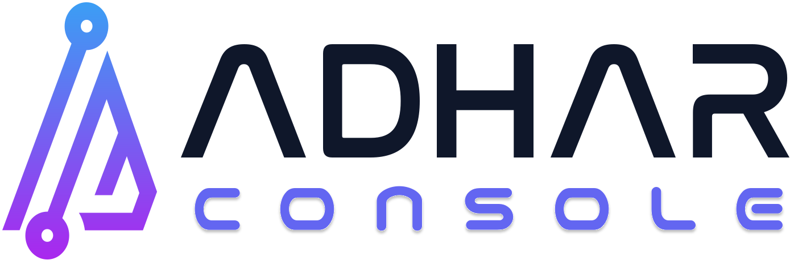
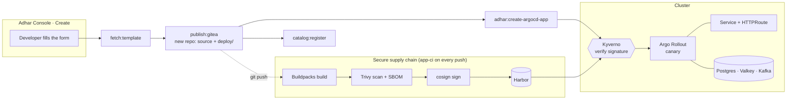

<div align="center">

<picture>
  <source media="(prefers-color-scheme: dark)" srcset=".github/assets/adhar-logo-dark.svg">
  
</picture>

# Adhar Templates

**Golden paths for the Adhar Internal Developer Platform.**<br>
Pick a template in the Adhar Console, fill in a short form, and get a running,
signed, observable service, with no boilerplate and no infra tickets.

[](https://backstage.io/docs/features/software-templates/)
[](https://argo-cd.readthedocs.io/)
[](#the-secure-supply-chain)
[](https://www.crossplane.io/)
[](#license)

[Templates](#template-catalog) · [How it works](#how-it-works) · [Spring Boot backing services](#spring-boot-pick-your-backing-services) · [Authoring](#authoring-a-template) · [Local dev](#run-it-locally)

</div>

---

## Why

Starting a new service usually means a week of glue work before the first
feature: a build, a registry, an image scan, a signature, manifests, an ingress
route, a database, dashboards, an entry in the catalog. Each template here does
all of that in one step. The generated repository belongs to your team, so you
can customise and maintain it like any other code, and it is already wired to
the platform:

- 🔐 **Secure by default.** Images are built with buildpacks (no Dockerfile),
  scanned with Trivy, given an SBOM, signed with cosign, and checked again by
  Kyverno at admission. If the platform did not sign an image, it does not run.
- 🚀 **Progressive delivery.** Argo CD syncs `deploy/`, and Argo Rollouts shifts
  traffic to new versions in canary steps.
- 📈 **Observable from the first request.** OpenTelemetry sends traces, metrics
  and logs to Tempo, Mimir and Loki with nothing to configure.
- 🧩 **Backing services on demand.** PostgreSQL, a Valkey cache and Kafka are
  provisioned next to the app, and their connection details reach it as
  environment variables, never as committed secrets.
- 📚 **Documented and catalogued.** Every app ships with TechDocs (`docs/` and
  `mkdocs.yml`) and registers itself in the Service Catalog with its owner.

## Template catalog

### Applications

Each of these creates its own Gitea repository (source plus a GitOps `deploy/`
tree) and an Argo CD Application.

| Template | Stack | Backing services | Highlights |
|---|---|---|---|
| [`springboot-web-service`](templates/springboot-web-service) | Java 25 · Spring Boot 4 · Adhar Kit | Postgres · Valkey · Kafka (each optional) | ⭐ Recommended Java golden path |
| [`springboot-hexagon-service`](templates/springboot-hexagon-service) | Java · Spring Boot · Adhar Kit | Postgres (optional) | Ports and adapters layout |
| [`quarkus-web-service`](templates/quarkus-web-service) | Java · Quarkus | Postgres (optional) | Fast startup, low memory |
| [`nodejs-web-service`](templates/nodejs-web-service) | Node.js · Express | Postgres (optional) | |
| [`go-web-service`](templates/go-web-service) | Go · net/http | Postgres (optional) | Minimal image, OTel built in |
| [`python-web-service`](templates/python-web-service) | Python · Flask | Postgres (optional) | |
| [`tanstack-start-fullstack-app`](templates/tanstack-start-fullstack-app) | TanStack Start · Adhar UI | Postgres (optional) | Full-stack SSR + API routes |
| [`react-spa-app`](templates/react-spa-app) | React · Vite · Adhar UI | | Static SPA |
| [`angular-spa-app`](templates/angular-spa-app) | Angular · Adhar UI | | Static SPA |
| [`agent-service`](templates/agent-service) | Python AI agent | | Isolated `AgentWorkload` with a gateway identity |

### Self-service resources

These are standalone resources provisioned through the Adhar control plane
(Crossplane), each with a connection Secret in your namespace.

| Template | Provisions |
|---|---|
| [`postgres-database`](templates/postgres-database) | PostgreSQL database |
| [`redis-cache`](templates/redis-cache) | Valkey (Redis-compatible) cache |
| [`kafka-cluster`](templates/kafka-cluster) | Strimzi Kafka (KRaft) with topics |
| [`object-bucket`](templates/object-bucket) | S3-compatible object storage bucket |
| [`search-cluster`](templates/search-cluster) | OpenSearch cluster |
| [`vector-database`](templates/vector-database) | Qdrant vector database |
| [`secret`](templates/secret) | Managed Secret |
| [`environment`](templates/environment) | Environment (namespace) |
| [`repository`](templates/repository) | Git repository |

### Ownership hierarchy

The [`organisation`](templates/organisation) → [`team`](templates/team) →
[`project`](templates/project) → [`application`](templates/application)
templates model who owns what. The Service Catalog, scorecards and on-call
routing all read that model.

## How it works



1. The **platform bootstrap** mirrors this repository into Gitea and registers
   [`catalog-info.yaml`](catalog-info.yaml), a Backstage `Location` that lists
   every template, so all of them appear under **Create**.
2. **Scaffolding** renders the template's `skeleton/` with the form values and
   publishes it to a new Gitea repository. It then creates an Argo CD
   Application for `deploy/` and registers the component in the catalog.
3. **Every push** runs the platform's `app-ci` pipeline. The new repository has
   nothing to define.
4. **Argo CD** syncs `deploy/`. Kyverno admits only the signed image, and Argo
   Rollouts rolls it out as a canary. Backing-service claims in the same tree
   are reconciled by CloudNativePG and the Crossplane control plane.

### The secure supply chain

| Stage | Tool | Guarantee |
|---|---|---|
| Build | Cloud Native Buildpacks (kpack) | Reproducible image, no Dockerfile drift |
| Check | gitleaks, Trivy (source + manifests), unit tests | Leaks and vulnerable dependencies fail the build |
| Scan | Trivy (image) + syft SBOM | Enforced severity gate, SBOM attested |
| Sign | cosign | Signs the digest only after every gate passes |
| Admit | Kyverno `verify-supply-chain-images` | Unsigned images never start, including ones applied by hand |
| Deploy | Argo CD + Argo Rollouts | Git is the source of truth, and a revert is the rollback |

## Spring Boot: pick your backing services

`springboot-web-service` has a **Backing services** step in its form. Every
option is an unticked checkbox, so you only tick what the service needs. Each
one you select adds a manifest to `deploy/`, its dependencies to `pom.xml`,
configuration, sample code and a local container in `compose.yaml`:

| Option | Provisioned by | Injected as | Sample code |
|---|---|---|---|
| **PostgreSQL database** | CloudNativePG `Cluster` with WAL archiving and a daily backup | `SPRING_DATASOURCE_URL` / `_USERNAME` / `_PASSWORD` | `GET /db` |
| **Valkey cache** (with a TTL) | Control-plane `Database` claim (`engine: redis`) | `SPRING_DATA_REDIS_URL`, used by **adhar-kit-cache** as the `@Cacheable` store | `GET`/`DELETE /cache/{key}` |
| **Kafka event stream** (topic and partitions) | Control-plane `Messaging` claim (Strimzi KRaft) | `SPRING_KAFKA_BOOTSTRAP_SERVERS` | `POST`/`GET /events` with a `@KafkaListener` |

Both Spring templates also have a **Require authentication (Keycloak JWT)**
checkbox, ticked by default. When it is ticked, every endpoint except
`/actuator/health` and `/actuator/info` needs a bearer token from the platform's
`adhar` realm, checked against the realm's JWKS by Adhar Kit's security module.
When it is unticked, the service is public. Health probes are open either way.

Credentials stay in Secrets that the platform generates. The generated code
contains no hostnames and no passwords, and every setting falls back to the
`localhost` ports in `compose.yaml` for local development.

## Repository layout

```text
adhar-templates/
├── catalog-info.yaml          # Backstage Location: registers every template
├── org.yaml                   # owner groups the templates and OwnerPicker use
└── templates/
    └── <name>/
        ├── template.yaml      # the form (parameters) + scaffolder steps
        └── skeleton/          # rendered into the new app's repository
            ├── catalog-info.yaml   # the new component's catalog entry
            ├── mkdocs.yml, docs/   # TechDocs: overview, architecture, runbook
            ├── <app source>
            ├── compose.yaml        # local backing services (where offered)
            └── deploy/             # GitOps tree Argo CD syncs
                ├── rollout.yaml    # Argo Rollout (canary) of the signed image
                ├── service.yaml
                ├── httproute.yaml  # Cilium Gateway route
                ├── database.yaml   # CloudNativePG cluster   (if requested)
                ├── cache.yaml      # Valkey claim            (if requested)
                └── kafka.yaml      # Kafka claim + topics    (if requested)
```

## Authoring a template

1. Copy the closest existing template under `templates/`.
2. Edit `template.yaml`: set `metadata.name`, `title`, `description` and `tags`,
   then add form `parameters` and pass them to `fetch:template` as `values`.
3. In `skeleton/`, reference values as `${{ values.name }}` and use
   ` … ` for optional pieces. Wrap a whole
   manifest in a condition, as `deploy/database.yaml` does, so it renders empty
   when the option is off.
4. Add the template to `targets` in [`catalog-info.yaml`](catalog-info.yaml).
5. Follow these conventions:
   - **Leave `hostname` as the local fallback.** The Console and CLI replace it
     with the cluster's real base domain before rendering.
   - **Commit no secrets.** Reference Secrets by name from `deploy/rollout.yaml`.
   - **Set probes, requests and limits** on every container, with probe
     timeouts above one second. The scorecard checks for all of them.
   - **Ship `docs/`** that explain the generated service rather than the
     template.

## Run it locally

The whole chain runs on a local `adhar up` Kind cluster: build, sign, scan,
verify, deploy, and real databases, caches and brokers. Behaviour on the
platform matches behaviour on your laptop, and no cloud account is needed.

**Platform prerequisites** (all enabled in the local profile): the
`supply-chain` package (kpack builder `adhar-builder`, the `adhar-pipeline`
service account, the cosign key and the `verify-supply-chain-images` Kyverno
policy), plus `harbor`, `cnpg`, `kyverno`, `argo-rollouts`, and the Crossplane
control plane for cache, Kafka and other self-service resources.

## License

[Apache-2.0](https://www.apache.org/licenses/LICENSE-2.0)
